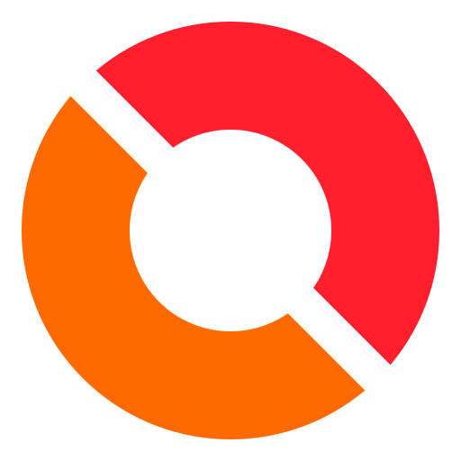

  

<h1 align="center">Oredlab</h1>

Developer • AI • local download

<h1 align="center">Ored AI - Runs on your machine </h1>

  <b>oredlab</b> is an independent AI model built from the ground up, designed to be accessible, downloadable, and free to run locally.

<h2>🌐 Live Site</h2>

<table>
  <tr>
    <td><b>URL</b></td>
    <td><a href="https://oredlab.com">oredlab.com</a></td>
  </tr>
  <tr>
    <td><b>Hosting</b></td>
    <td>Cloudflare Workers</td>
  </tr>
  <tr>
    <td><b>Repo</b></td>
    <td><a href="https://github.com/Koe458-ui/oredlab">Koe458-ui/oredlab</a></td>
  </tr>
</table>

<h2 align="center">✨ Features</h2>

  Everything Ored is built around: simple, private and yours.

<table>
  <tr>
    <th align="center">Feature</th>
    <th align="center">Details</th>
  </tr>
  <tr>
    <td align="center">🧱 <b>Built from scratch</b></td>
    <td align="center">Our own model, not a wrapper around someone else's</td>
  </tr>
  <tr>
    <td align="center">⬇️ <b>Free local download</b></td>
    <td align="center">Download Ored and keep it on your own PC</td>
  </tr>
  <tr>
    <td align="center">💻 <b>Local inference</b></td>
    <td align="center">Runs on your machine, no cloud AI services</td>
  </tr>
  <tr>
    <td align="center">🧠 <b>Training and checkpoints</b></td>
    <td align="center">Currently in training, checkpoints shared when stable</td>
  </tr>
  <tr>
    <td align="center">🔓 <b>Open development</b></td>
    <td align="center">Public repo and an open roadmap</td>
  </tr>
  <tr>
    <td align="center">🔒 <b>Privacy and independence</b></td>
    <td align="center">Your prompts stay on your machine, no accounts or API keys</td>
  </tr>
</table>

  Want to help? See <a href="CONTRIBUTING.md">CONTRIBUTING.md</a>

<h2 align="center">🗺️ Roadmap</h2>

  Where Ored is today and where it's going.

  

  
  
  

<table>
  <tr>
    <th align="center">Status</th>
    <th align="center">Milestone</th>
    <th align="center">Details</th>
  </tr>
  <tr>
    <td align="center"></td>
    <td align="center"><b>Website and domain</b></td>
    <td align="center"><a href="https://oredlab.com">oredlab.com</a> fully available</td>
  </tr>
  <tr>
    <td align="center"></td>
    <td align="center"><b>Open repository</b></td>
    <td align="center">Apache-2.0, contributing, security policy</td>
  </tr>
  <tr>
    <td align="center"></td>
    <td align="center"><b>First training run</b></td>
    <td align="center">Training from scratch</td>
  </tr>
  <tr>
    <td align="center"></td>
    <td align="center"><b>First public checkpoint</b></td>
    <td align="center">Downloadable weights on Releases</td>
  </tr>
  <tr>
    <td align="center"></td>
    <td align="center"><b>Local inference</b></td>
    <td align="center">Run offline, no cloud, no API key</td>
  </tr>
  <tr>
    <td align="center"></td>
    <td align="center"><b>Setup guides and evaluation</b></td>
    <td align="center">Windows, macOS, Linux and results</td>
  </tr>
  <tr>
    <td align="center"></td>
    <td align="center"><b>Packaged desktop app</b></td>
    <td align="center">One-click installer</td>
  </tr>
</table>

  Updated as development moves. Follow along on <a href="https://oredlab.com">oredlab.com</a>

<h2>🗺️ Ored Model Roadmap</h2>

<table>
  <tr>
    <th>Model Parameters</th>
    <th>Status</th>
    <th>Notes</th>
    <th>Download</th>
  </tr>
  <tr>
    <td align="center">1M</td>
    <td align="center">✅ Done</td>
    <td align="center">First prototype</td>
    <td align="center"><a href="#">Download</a></td>
  </tr>
  <tr>
    <td align="center">10M</td>
    <td align="center">✅ Done</td>
    <td align="center">Improved quality</td>
    <td align="center"><a href="#">Download</a></td>
  </tr>
  <tr>
    <td align="center">50M</td>
    <td align="center">🔄 In Progress</td>
    <td align="center">Training now</td>
    <td align="center">Coming soon</td>
  </tr>
  <tr>
    <td align="center">100M</td>
    <td align="center">⏳ Pending</td>
    <td align="center">Planned</td>
    <td align="center">-</td>
  </tr>
  <tr>
    <td align="center">250M</td>
    <td align="center">⏳ Pending</td>
    <td align="center">Planned</td>
    <td align="center">-</td>
  </tr>
  <tr>
    <td align="center">500M</td>
    <td align="center">⏳ Pending</td>
    <td align="center">Planned</td>
    <td align="center">-</td>
  </tr>
  <tr>
    <td align="center">1B</td>
    <td align="center">⏳ Pending</td>
    <td align="center">Planned</td>
    <td align="center">-</td>
  </tr>
</table>

<h1 align="center">Licence</h1>

Copyright © 2026 OREDLAB

Licensed under the Apache License, Version 2.0.

You may use, modify, and distribute this project in accordance with the terms of the Apache License 2.0.

See the ""LICENSE"" (LICENSE) file for the complete license terms.

<h1 align="center">Team</h1>

The oredlab Team — oredlab.com
  
  - Albaze (Harsh)
  - Koe (Anish)
  

